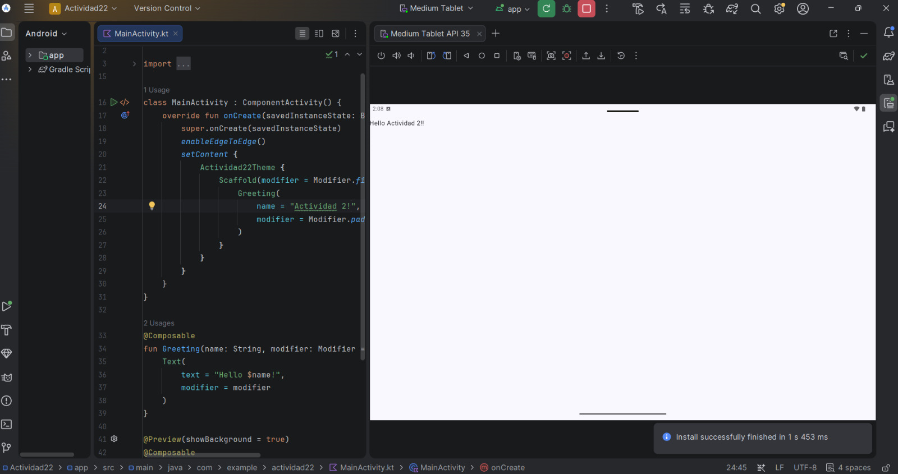
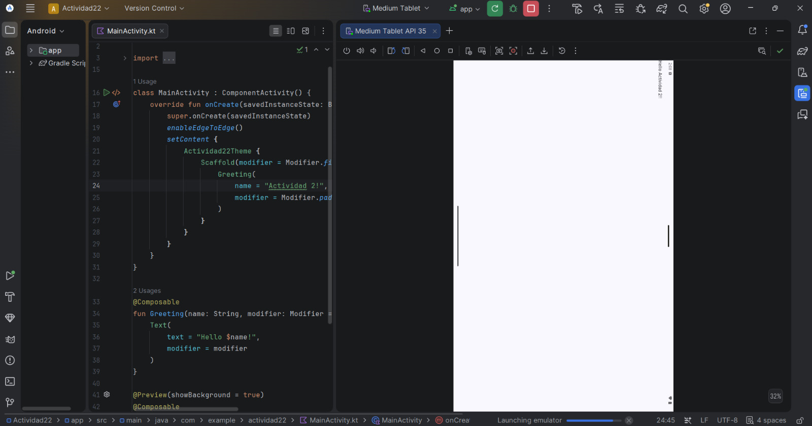
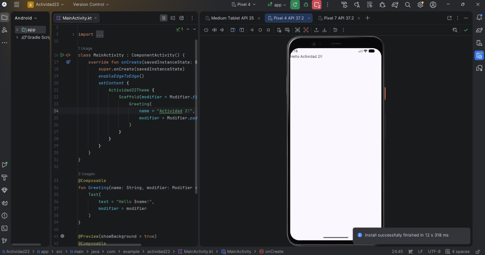
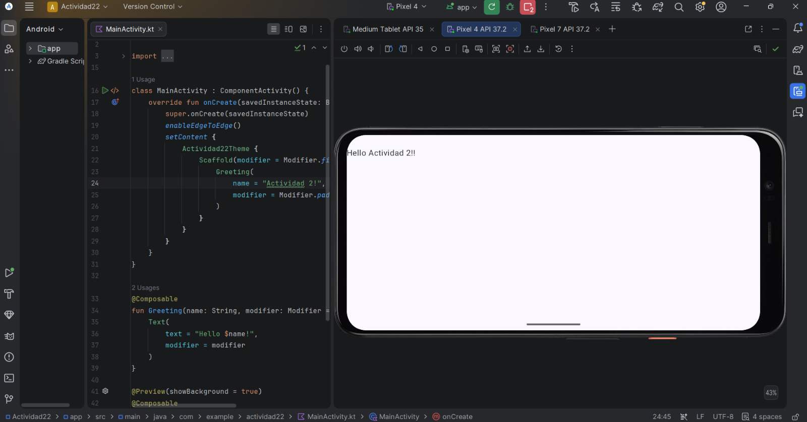
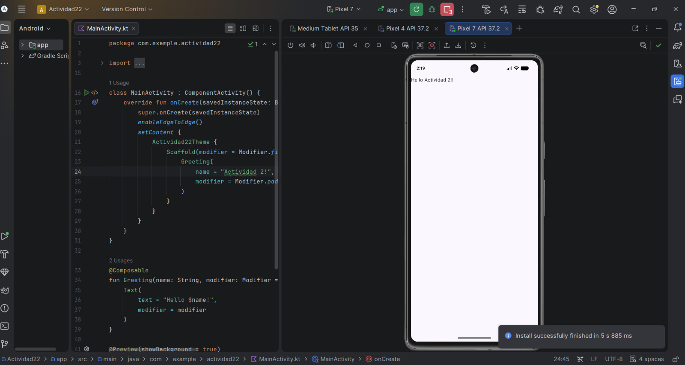
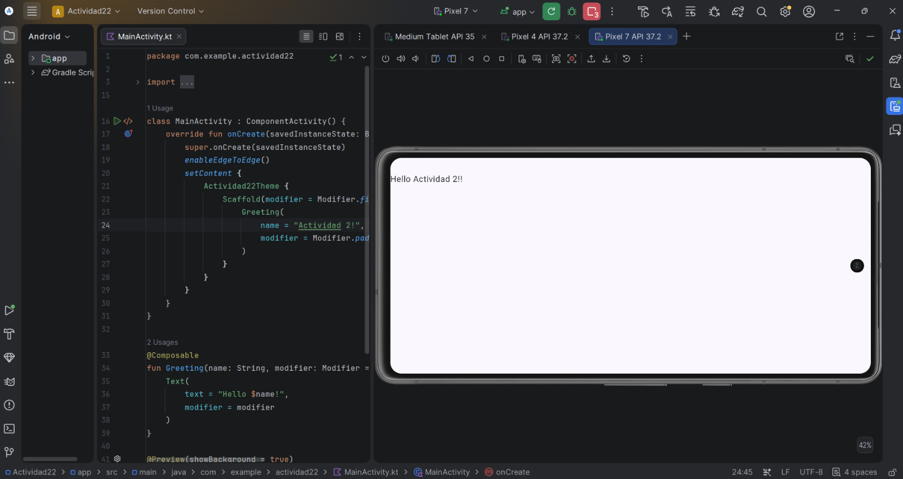

## 1. Tablet
### Ficha de Configuración:
* **Perfil:** Medium Tablet
* **API / Versión:** API 35
* **Resolución:** Alta densidad optimizada para tablets
* **Densidad:** xhdpi / tvhdpi
* 
* **Vista Vertical Tablet:**
  

* **Vista Horizontal Tablet:**
  

## 2.Móvil Antiguo (Pixel 4)
### Ficha de Configuración:
* **Perfil:** Pixel 4
* **API / Versión:** API 34 / API 35
* **Resolución:** 1080 x 2280 píxeles
* **Densidad:** 440 dpi (xxhdpi)
* **Vista Vertical Movil Antiguo:**
* 
  

* **Vista Horizontal Movil Antiguo:**
  

## 3.Móvil Nuevo
### Ficha de Configuración:
* **Perfil:** Pixel 7
* **API / Versión:** API 34 / API 35
* **Resolución:** Pantalla alargada moderna 
* **Densidad:** 420-480 dpi
* 
* **Vista Vertical Movil Nuevo:**
  

* **Vista Horizontal Movil Nuevo:**
  

*Al ejecutar el código en los diferentes dispositivos la aplicación se encuadra perfectamente en las diferentes
resoluciones, también pasa lo mismo al girar la pantalla.*