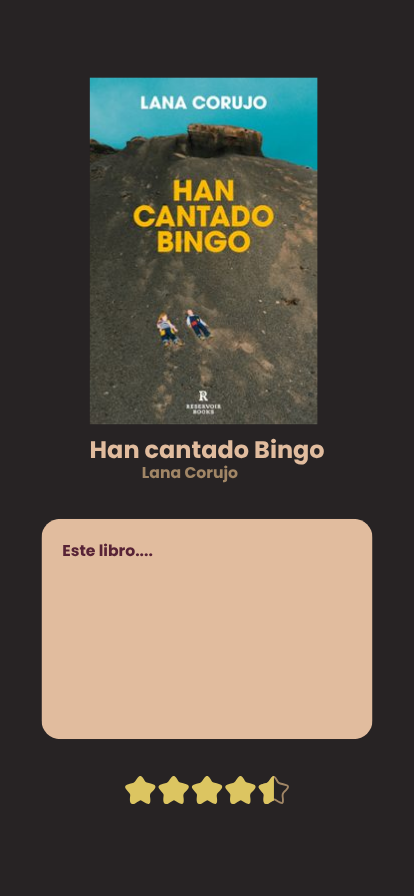

# Plantilla: propuesta del Proyecto A

---

## 0 · Datos

| | |
|---|---|
| **Nombre de la app** |Booky |
| **Autor/a** | Rocio Romero Diaz|
| **Fecha** | 30/ 09/2026 |

---

## 1 · La idea en una frase

> Qué hace tu app y para quién, en una sola frase.
>Permite a los lectores hacer un seguimiento de sus lecturas pasadas, presentes y futuras para no perderse ni una sola inmersión lectora.
> Fórmula: «Una app que permite a [quién] hacer [qué] para [para qué].»

---

## 2 · El problema

> ¿Qué problema resuelve? ¿Cómo se resuelve hoy sin tu app?
Muchas veces vemos un libro en una librería, hacemos una foto a a portada y esta acaba perdida por la galería de nuestro teléfono.
También queremos tener un registro de los libros que hemos leído, ya sea para recomendarlos o para poder anotar las sensaciones que nos generó leerlo.
El bloqueo lector también es un gran problema: "¿Qué puedo leer que me guste?" es una pregunta bastante frecuente, por lo que una lista
con recomendaciones de libros por género sería una solución fantástica para poder encontrar una lectura idónea.
---

## 3 · Personas usuarias

> ¿Quién la va a usar? Describe a una persona concreta: edad, soltura con la
> tecnología, cuándo y dónde abre la app, cuánto tiempo le dedica y qué pasa
> si le falla.
La aplicación estaría dedicada sobretodo a jóvenes entre 16 - 30 años que ya tienen soltura con la tecnología.
Los momentos donde más se abriría la aplicación serían en casa, tras acabar un libro, o en una librería para anotar su próxima lectura.
El tiempo dentro de la aplicación será entre 5 y 15 minutos, ya que el usuario puede entrar solo para registrar una lectura o por otro lado, buscar una lectura nueva.
Si la aplicación fallara, no sería un problema grave pero sí supondría una gran frustración para el usuario al perder sus datos como reseñas y el historial de sus lecturas, lo cuál podría suponer una pérdida de usuarios en la aplicación.

---

## 4 · Funcionalidades

### Imprescindibles (sin esto la app no tiene sentido)

| # | Funcionalidad |
|---|---------------|
| F1 | Registrar lectura actual (añadir título, autor, portada y estado(leyendo, leído))|
| F2 | Registrar próxima lectura (quiero leer y pestaña de pendientes)|
| F3 | Buscar recomendaciones de libros (mediante API externa)|

### Opcionales (si sobra tiempo)

| # | Funcionalidad |
|---|---------------|
| O1 | Escribir y guardar reseñas sobre los libros leídos |
| O2 | Buscar recomendaciones de libros (mediante API externa) |

---

## 5 · Pantallas

| Pantalla | Para qué sirve | Se llega desde |
|----------|----------------|----------------|
|Pantalla de Inicio| Mostrar la lectura actual y un resumen de las lecturas pasadas | (arranque) |
|Pantalla de Pendientes | Ver la lista de libros que quieres leer  | Una lista en la pantalla principal |
|Pantalla de Leídos | Ver la lista de libros leídos | Desde un detalle "ver todos" en la pantalla principal |
|Pantalla de Reseñas | Leer reseñas pasadas o añadir nuevas reseñas | Desde el detalle de un libro en la pantalla principal |
|Pantalla de Recomendaciones | Mostrar una lista de libros recomendados | Desde una lista en la pantalla principal |

---

## 6 · Bocetos

> Dibuja las pantallas principales. A mano y fotografiado es válido.
> Pega aquí las imágenes o indica el nombre de los archivos adjuntos.
#### Pantalla Principal

> *Descripción:* En la pantalla principal encontramos el título de bienvenida. También aparece el libro actual y justo abajo los libros ya leídos junto con un botón de navegación que nos llevaría a otra pantalla.
> También contamos con un botón que desplegaría un menú de opciones (última captura) situado arriba a la izquierda.

#### Lecturas Pendientes

> *Descripción:* En la cabecera encontramos el título de la pantalla. Luego encontramos una barra búsqueda y la lista de libros en formato PNG/JPG.
> En la esquina derecha inferior, encontramos un botón de acción que nos abriría la cámara y nos permitiría registrar un libro en esta pantalla por foto.

#### Libros Leídos

> *Descripción:* En la cabecera encontramos el título de la pantalla. Volvemos a ver una barra de búsqueda y por último la lista de libros en formato PNG/JPG

#### Pantalla de Reseña

> *Descripción:* En la cabecera encontramos el título de la pantalla. En grande nos apareceria la imagen del libro seguido de un cuadro de texto donde guardaríamos la reseña.
> Justo debajo un sistema de valoración de estrellas.

#### Recomendaciones

> *Descripción:* En la cabecera encontramos el título de la pantalla. Volvemos a encontrar una barra de búsqueda conectada a la API.
> Por último nos encontraríamos diferentes categoría que nos mostrarían las portadas de los libros.

#### Menú de Opciones

> *Descripción:* Aquí una breve explicación de donde está situado el menú despeglable de opciones y su contenido.
>

#### Pantalla de búsqueda

> *Descripción:* Esta pantalla nos muestra el formulario de registro de libro en caso de que fallase la búsqueda por sensor.
---

## 7 · Qué datos guarda la app

| Tipo de dato | Campos | Ejemplo |
|--------------|--------|---------|
|Libro | titulo, autor, portada, estado | "Trono de Cristal", "Sarah J. Maas", "portada.png", "leyendo" |
|Reseña | libro_id, comentario, puntuacion | "Trono de Cristal", "Me ha encantado", 4.5 |

---

## 8 · Encaje con los requisitos del módulo

> Apartado obligatorio: ninguna casilla puede quedar vacía.

| Requisito | Dónde encaja en tu app | Tema |
|-----------|------------------------|------|
| **Persistencia de datos** — la información sobrevive al cerrar la app |Los libros añadidos, sus estados y las reseñas se almacenan localmente para no perderse al cerrar la aplicación | 4 |
| **Servicio web** — la app consulta datos por internet | Una API pública y gratuita de libros como Open Library API| 5 |
| **Sensor o localización** | Utilización de la cámara como lector de códigos de barras para registrar libros de forma rápida| 6 |
| **Contenido multimedia** — foto, audio, vídeo o animación | Imágenes de las portadas de los libros en formato PNG/JPG para cada obra | 7 |

---

## 9 · Riesgos

| Lo que me preocupa | Plan B |
|--------------------|--------|
| Que la API falle por falta de respuesta o conexión | Utilizará un listado de libros de ejemplo guardados localmente para que la pantalla de recomendaciones nunca aparezca vacía|
| Que el lector de código de barras falle | Dejar sólo la opción de búsqueda de libros dentro de la API externa|
|Fallo en la persistencia de datos| Se simplifica el guardado de datos en archivos

---

## Antes de entregar

- [ ] La idea cabe en una frase.
- [ ] El público es una persona concreta, no «todo el mundo».
- [ ] Hay **3 o 4** funcionalidades imprescindibles, no diez.
- [ ] Cada funcionalidad imprescindible tiene su pantalla.
- [ ] Hay bocetos de las pantallas principales.
- [ ] **Las cuatro casillas del apartado 8 están rellenas.**
- [ ] Está identificado al menos un riesgo con su plan B.
