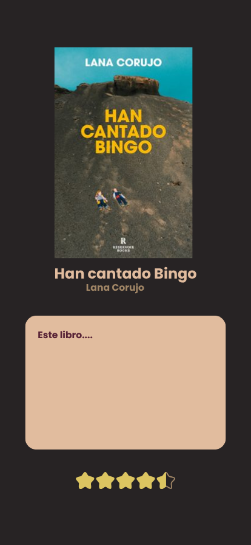

## Diseño de alta fidelidad de una página de detalle

En este apartado vamos a analizar la pantalla de detalle, que es mi proyecto corresponde al apartado de "Reseña"

## Layouts

* **`Box`:** Define el fondo general de la pantalla.
* **`Column` (Contenedor Principal):**
    1. Portada del libro ampliada.
    2. Bloque de metadatos (título, autor, valoración).
    3. Área de texto para la reseña.
* **`verticalScroll` (Modificador de desplazamiento):** Permite que todo el contenido de la página sea deslizable.

## Componentes
* **Portada Ampliada (`Image`):** Componente visual principal que muestra la portada del libro.
* **Títulos y Metadatos (`Text`):**
    * Título principal del libro.
    * Nombre del autor.
* **Área de Reseña(`Card` o contenedor de texto):** Bloque dedicado a mostrar y almacenar la opinión del usuario.
* **Sistema de Valoración por Estrellas (`Row` de iconos `Icon` Estrellas):** Componente interactivo situado en la parte inferior que permite calificar la lectura mediante un sistema de puntuación por estrellas.
* **Control de Salida (A implementar): Se puede salir mediante la propia opción del teléfono de "volver atrás" o añadiendo un pequeño botón de salida (x). 