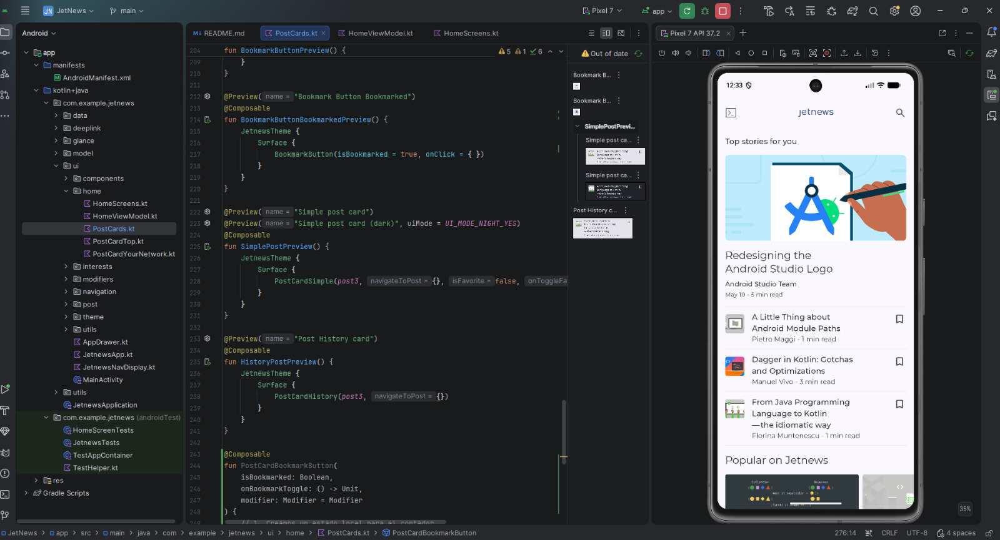

## Modificación funcional de una app existente

* Primero cloné el repositorio de GitHub en Android Studio. Luego tuve muchos problema se sincronización con el Gardle.
* Una vez arreglado, abrí la aplicación desde la carpeta JetNews en un emulador de Pixel 7.
* Para editar el código navegué desde: app -> koltin+java -> ui -> home -> PostCards.kt 
* En la imagen siguiente se puede apreciar mejor lo mencionado anteriormente.

